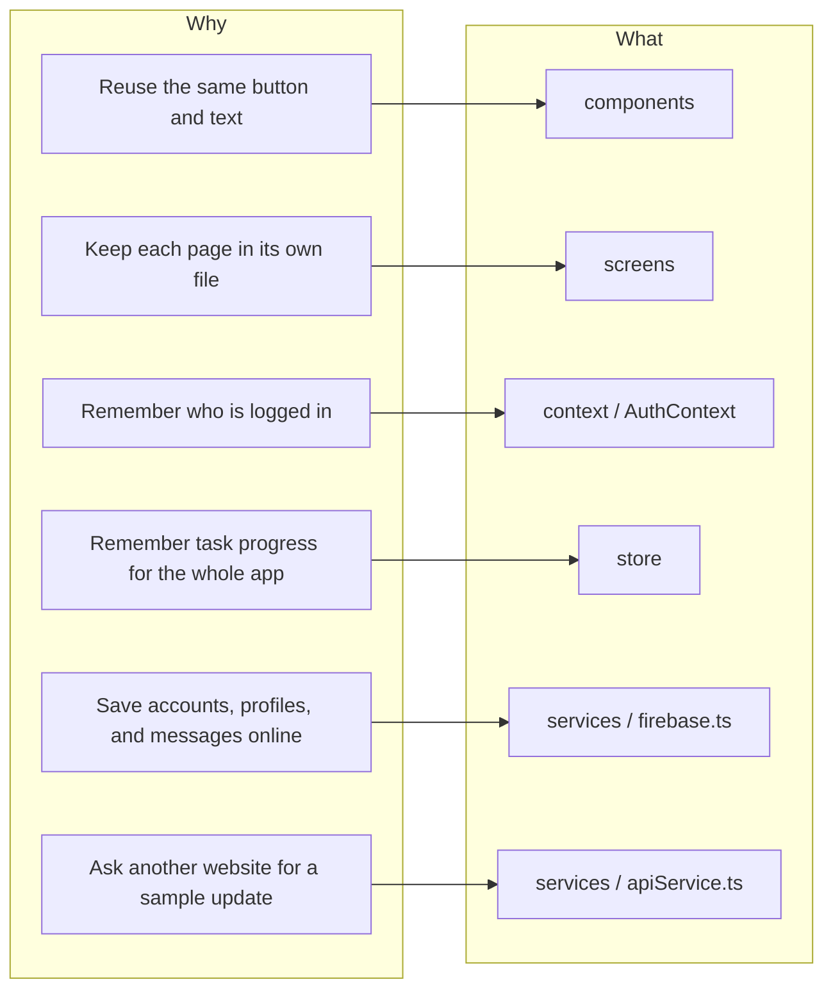
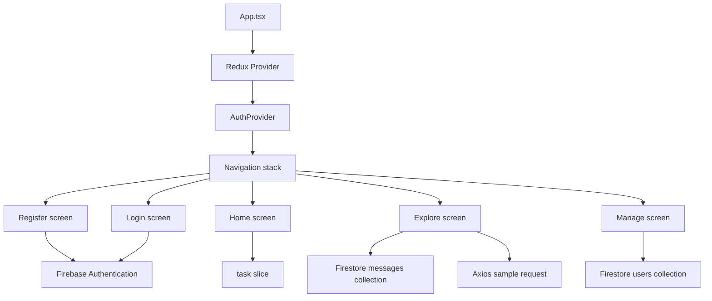
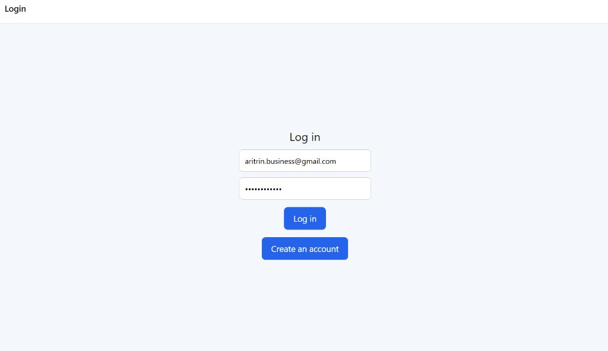
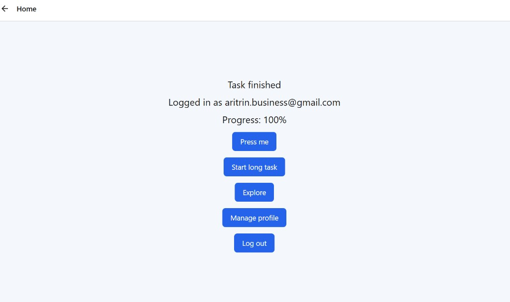
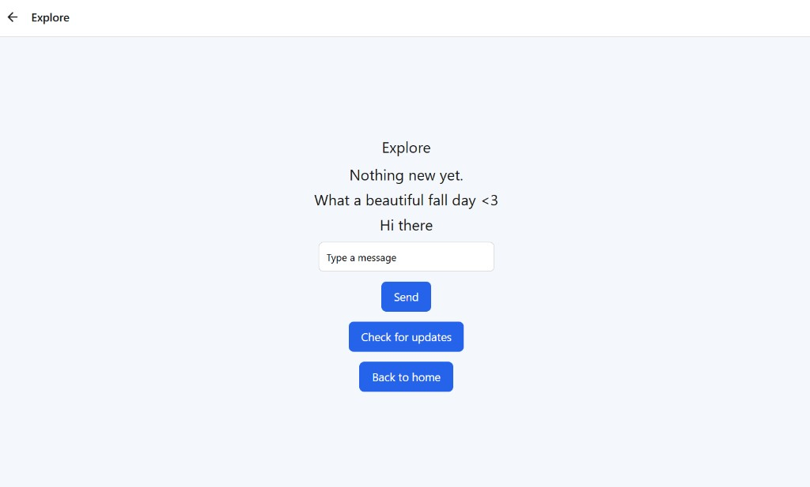
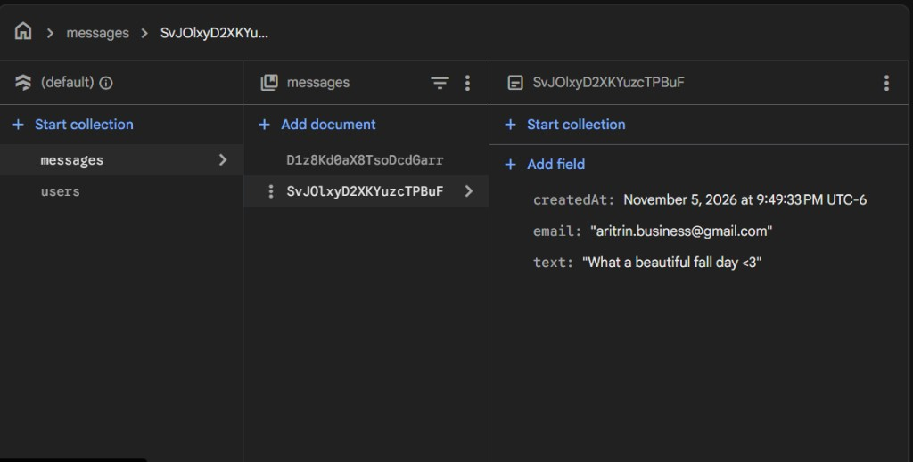
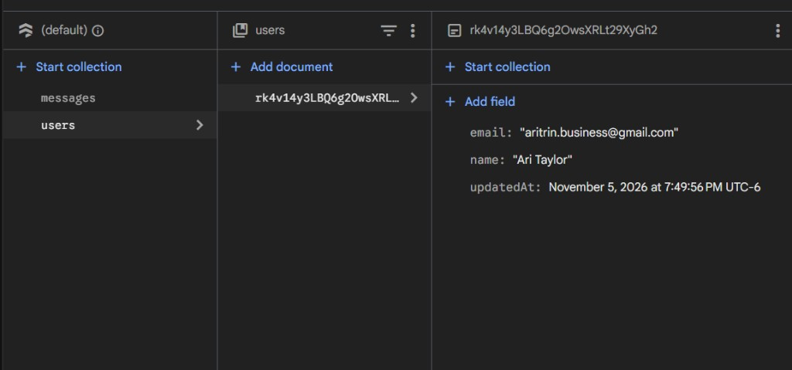

# MobileApplication

## Table of Contents

- [Description](#description)
- [How It Works — The Why & What Diagram](#how-it-works--the-why--what-diagram)
- [The project structure (what lives where)](#the-project-structure-what-lives-where)
- [Features](#features)
- [Screenshots](#screenshots)
- [Usage / Examples](#usage--examples)
- [Example: what a message looks like in the code](#example-what-a-message-looks-like-in-the-code)
- [Example: how a profile document gets its id](#example-how-a-profile-document-gets-its-id)
- [Installation](#installation)
- [Tech Stack](#tech-stack)
- [Author Information](#author-information)

## Description

MobileApplication is a React Native app made with Expo and TypeScript. A person can create an account, log in, save a profile, send live messages, and watch a slow task count from 0% to 100%.

The code is split into small pieces:

- Screens are the full pages.
- Components are the reusable pieces on those pages.
- Context remembers who is logged in.
- Redux remembers the slow-task progress.
- Firebase stores the account, the profile, and the messages.
- Axios asks a practice website for one sample update.

## How It Works — The Why & What Diagram

Each box on the left is the reason a piece of code exists. The box on the right is the folder or file that does that job.



When the app opens, those pieces connect like this:



### The project structure (what lives where)

```text
MobileApplication
├── App.tsx                         starts Redux, auth, and page navigation
├── .env.local                      Firebase keys, kept off GitHub
├── components
│   ├── CustomButton.tsx            blue button used on every page
│   ├── ThemedText.tsx              shared text style
│   └── __tests__                   Jest tests for those two pieces
├── context
│   └── AuthContext.tsx             shared email and login flag
├── navigation
│   └── types.ts                    names of the pages
├── screens
│   ├── LoginScreen.tsx
│   ├── RegisterScreen.tsx
│   ├── HomeScreen.tsx
│   ├── ExploreScreen.tsx
│   └── ManageScreen.tsx
├── services
│   ├── firebase.ts                 starts Firebase Auth and Firestore
│   └── apiService.ts               Axios sample call and the slow task
├── screenshots                     pictures of the working app
├── store
│   ├── store.ts                    the Redux notebook
│   └── taskSlice.ts                progress line and home sentence
└── styles
    └── globalStyles.ts             shared page color and layout
```

## Features

- Create an account with email and password through Firebase Authentication.
- Log in and log out. The login email is kept in `AuthContext`.
- Move between Login, Register, Home, Explore, and Manage with React Navigation.
- Save a profile name in the Firestore `users` collection.
- Send a message and see it appear live from the Firestore `messages` collection.
- Run a simulated `/long-task` job that reports 0%, 25%, 50%, 75%, and 100%.
- Store that progress in Redux Toolkit.
- Fetch one sample title from a practice website with Axios.
- Test `ThemedText` and `CustomButton` with Jest.

## Screenshots

### Sign in

The login page with an email and password ready to submit.



### Successful login

The home page after login. It shows the signed-in email, and the slow task has reached 100%.



### Message sent

The Explore page after a message is sent. The new text appears with the older messages.



### Message saved in Firestore

The same message stored in the `messages` collection, with the email and the time it was created.



### Profile saved in Firestore

The profile stored in the `users` collection, with the name, email, and update time.



## Usage / Examples

- Open the app and create an account. The password needs at least 6 characters.
- Log in with that same email and password. The home page opens.
- Press **Start long task**. The progress line moves to 100%, then the sentence changes to `Task finished`.
- Open **Explore**, type a message, and press **Send**. The message shows on the page and in Firestore.
- Open **Manage profile**, type a name, and press **Save profile**. Firestore stores that name under the signed-in person's id.
- Press **Log out**. The login page opens.

### Example: what a message looks like in the code

`ExploreScreen` saves one document in the `messages` collection. A listener on that same collection updates the page when the document arrives.

```tsx
await addDoc(collection(db, 'messages'), {
  text: draft.trim(),
  email: auth.currentUser?.email ?? 'guest',
  createdAt: serverTimestamp(),
});
```

### Example: how a profile document gets its id

The profile document id is the Firebase user id, `user.uid`. That keeps one profile document for each account.

```tsx
await setDoc(
  doc(db, 'users', user.uid),
  {
    name: name.trim(),
    email: user.email ?? '',
    updatedAt: serverTimestamp(),
  },
  { merge: true },
);
```

## Installation

1. Install Node.js. npm comes with it.
2. Clone the repository and open the project folder.
3. Install the packages:

```bash
npm install
```

4. Create a Firebase project and add a Web app.
5. Turn on Email/Password in Firebase Authentication.
6. Create a Firestore database in test mode.
7. In the project folder, create `.env.local` and paste your own Firebase values after each equals sign:

```text
EXPO_PUBLIC_FIREBASE_API_KEY=
EXPO_PUBLIC_FIREBASE_AUTH_DOMAIN=
EXPO_PUBLIC_FIREBASE_PROJECT_ID=
EXPO_PUBLIC_FIREBASE_STORAGE_BUCKET=
EXPO_PUBLIC_FIREBASE_MESSAGING_SENDER_ID=
EXPO_PUBLIC_FIREBASE_APP_ID=
```

8. Start the app:

```bash
npx expo start
```

9. Press `w` to open it in a browser.
10. Run the tests:

```bash
npm test
```

Do not commit `.env.local`. That file holds the Firebase keys.

## Tech Stack

- Expo and React Native
- TypeScript
- React Navigation
- Firebase Authentication
- Cloud Firestore
- Redux Toolkit and React Redux
- Axios
- Jest and React Native Testing Library

## Author Information

Ari Taylor | Full-Stack Web Development | Atlas

- LinkedIn: [linkedin.com/in/ari-taylor-8b8382366](https://linkedin.com/in/ari-taylor-8b8382366)
- Email: [aritrin.business@gmail.com](mailto:aritrin.business@gmail.com)
- GitHub: [@ari-trinity](https://github.com/ari-trinity)
